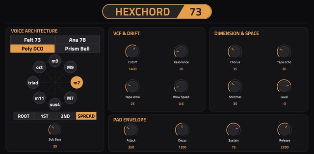

# HexChord 73 for MPC

[](https://github.com/Eurikon/mpc-vst-plugins/actions/workflows/hexchord-check.yml)
[](LICENSE)
[](https://github.com/Eurikon/mpc-vst-plugins/releases/download/hexachord-73-v1.0.0/HexChord-73-1.0.0-mpc-armv7.zip)



HexChord 73 is a stereo chord synthesizer for MPC standalone.<br>
Play one note to trigger a four-tone chord, with four overlapping chord slots and release tails.<br>
Choose from eight chords, four voicings and four synth engines: Felt 73, Ana 78, Poly DCO Pulse and Prism Bell.

**Current release:** 1.0.0, targeting ARMv7 and MPC OS 3.x.

| Engine | Sound |
| --- | --- |
| Felt 73 | Struck body and tine tones, with velocity-dependent bark and damping. |
| Ana 78 | Detuned saw and pulse oscillators, pitch drift and a resonant four-pole filter. |
| Poly DCO Pulse | Stable saw and PWM tones, an octave divider and stereo chorus. |
| Prism Bell | Inharmonic phase-modulation tones with separate strike and ring controls. |

## Playing

- **PERFORM:** the complete overview, including sound, chord, envelope and effects.
- **SYNTH:** larger controls and each engine's own timbre sliders and switches.
- **CHORD:** drag across the diagram to select a chord and voicing, or use the separate buttons.

The instrument sounds one octave below incoming notes.<br>
The first Q-Link column controls engine, chord, voicing and sub bass, from top to bottom.<br>
Enable MPC automation **Write** to record parameter changes, then **Read** for playback.<br>
Four factory presets restore each engine's default sound.<br>
Effects include chorus, tape wow, stereo tape echo and a bright feedback delay.

## Compatibility and performance

**Tested on:** MPC Live 2 Retro — Gen1 / AKAI MPC OS 3.9.1 and 3.10.<br>
This build targets ARMv7 and MPC OS 3.x.

The original sd88me CPU workload measured **p99 22.5%, maximum block 24.2%: WARN** on OS 3.9.1.<br>
Start with one or two instances and check the MPC project CPU meter.<br>
These figures measure one core's audio-block budget, rather than the overall CPU meter.

## Installation

Copy the release ZIP into `local-plugins/` on your [Plugin Manager USB](https://github.com/Eurikon/plugin-manager-usb-for-open-mpc) drive.<br>
Open the manager, choose **Local**, select HexChord 73 and install.<br>
Return to MPC, create a Plugin track and select HexChord 73.<br>
Use the manager to update, reinstall or remove it.

## Build and test

Requires Python 3, a C++17 compiler and Docker with ARMv7 support.<br>
Skin generation also uses Python 3.11 and Chromium, installed into the ignored build directory.<br>
The native plugin does not require Node.js or a WebAssembly runtime.

```sh
git clone https://github.com/Eurikon/mpc-vst-plugins.git
git clone https://github.com/sd88me/mpc-vst-plugins.git mpc-vst-build-tools
git -C mpc-vst-build-tools checkout fc1ea20ff83779d3f47fb43177f5284f59e57a99
export MPC_VST="$(cd mpc-vst-build-tools && pwd)"
cd mpc-vst-plugins/Instruments/HexaChord-73
bash test.sh
bash build.sh skin
bash build.sh
bash package.sh 1.0.0
```

`test.sh` runs the native engine and VST host tests with ASan/UBSan.<br>
`build.sh` compiles the ARM library using the standard upstream ARMv7 compiler image.<br>
Set `MPC_BUILD_IMAGE` to reuse an existing compatible shared compiler image.<br>
The supplied patches preserve native skin rendering and Q-Link behavior at the pinned upstream revision.<br>
`package.sh` checks that the CPU record belongs to the exact library and creates the catalog-valid ZIP.<br>
After changing the library, measure it again using the [upstream build and release procedure](https://sd88me.github.io/mpc-vst-plugins/workflow.html).

## Licensing

GPL-3.0-or-later for the original instrument code and artwork.<br>
The [sd88me MPC VST project](https://github.com/sd88me/mpc-vst-plugins) provides the MIT-licensed wrapper, skin and release tools.<br>
See [LICENSE](LICENSE) and [licenses/NOTICE.txt](licenses/NOTICE.txt) for the included third-party notices.
