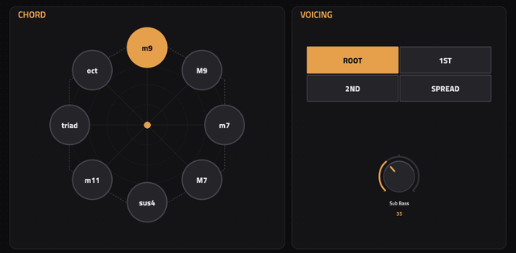

# HexChord 73 for MPC

[](https://github.com/Eurikon/mpc-vst-plugins/actions/workflows/hexchord-check.yml)
[](LICENSE)
[](https://github.com/Eurikon/mpc-vst-plugins/releases/download/hexachord-73-v1.1.0/HexChord-73-1.1.0-mpc-armv7.zip)



HexChord 73 is a stereo chord synthesizer for MPC standalone.<br>
Play one note to trigger a four-tone chord, with four overlapping chord slots and release tails.<br>
Choose from eight chords, four voicings and four synth engines: Felt 73, Ana 78, Poly DCO Pulse and Prism Bell.

**Version:** 1.1.0, with ARMv7 and AArch64 builds for MPC OS 3.x.

| Engine | Sound |
| --- | --- |
| Felt 73 | Struck body and tine tones, with velocity-dependent bark and damping. |
| Ana 78 | Detuned saw and pulse oscillators, pitch drift and a resonant four-pole filter. |
| Poly DCO Pulse | Stable saw and PWM tones, an octave divider and stereo chorus. |
| Prism Bell | Inharmonic phase-modulation tones with separate strike and ring controls. |

## Playing

- **PERFORM:** the complete overview, including sound, chord, envelope and effects.
- **SYNTH:** larger controls and each engine's own timbre sliders and switches.
- **CHORD:** drag across the diagram to select a chord and voicing, or use the separate buttons.

The instrument sounds one octave below incoming notes.<br>
In Screen mode, Q-Links follow the selected tab.<br>
On PERFORM, the first Q-Link column controls engine, chord, voicing and sub bass, from top to bottom.<br>
SYNTH maps filter/wow, ADSR and engine selection; CHORD maps chord, voicing and sub bass.<br>
Enable MPC automation **Write** to record parameter changes, then **Read** for playback.<br>
Four factory presets restore each engine's default sound.<br>
Effects include chorus, tape wow, stereo tape echo and a bright feedback delay.

## Compatibility and performance

**Tested on:** MPC Live 2 Retro — Gen1 / AKAI MPC OS 3.9.1, 3.10 and 3.10.1.<br>
Earlier firmware checks used previous releases.<br>
Version 1.1.0 was checked for loading, playback, controls, all three pages and project save/reload on OS 3.10.1.<br>
Gen2 builds pass ARM64 Linux host, sanitizer and repeated-unload checks; physical Gen2 testing remains pending.
The release ZIP passed all 24 offline installation/reinstallation/tamper/rollback/uninstallation checks.<br>
The official-format installation contains 341 files, verified by SHA-256 on MPC SD.

The original upstream CPU workload measured **p99 13.7%, maximum block 17.4%: PASS** on OS 3.10.1.<br>
These figures measure one core's audio-block budget, rather than the overall CPU meter.

Version 1.1.0 optimizes the native DSP following the Akai SDK performance guidance.<br>
Four-trigger playing uses approximately 29% less CPU for Ana, 54% for Felt, 25% for Poly and 45% for Prism in matched device tests.<br>
The interface, voice count, parameters and preset format are unchanged.<br>
Additional 32-frame stress tests still exceed the stricter local CPU targets; they are separate from the upstream PASS benchmark.

## Installation

On **MPC OS 3.10.1 or later**, extract the SDK-format ZIP.<br>
Copy its `Twisted Cable - VST - HexChord 73` folder into `VST2 Plugins` at the root of your SD card or USB drive.<br>
In Preferences → Enhancements (Beta), enable **Enable Enhancements** and **External Plugin Support**.<br>
Restart the MPC application if needed, then select HexChord 73 under **External Plugins** on a Plugin track.

On earlier supported firmware, install the appropriate ARMv7 or AArch64 ZIP through the [OpenMPC Plugin Manager](https://github.com/open-mpc/plugin-manager) or your existing [Plugin Manager USB](https://github.com/Eurikon/plugin-manager-usb-for-open-mpc).<br>
Save your project before scripted installation restarts MPC.

## Build and test

Requires Python 3, a C++17 compiler and Docker with ARMv7 and ARM64 support.<br>
Skin generation also uses Python 3.11 and Chromium, installed into the ignored build directory.<br>
The native plugin does not require Node.js or a WebAssembly runtime.

```sh
git clone https://github.com/Eurikon/mpc-vst-plugins.git
git clone https://github.com/open-mpc/mpc-vst-plugins.git mpc-vst-build-tools
git -C mpc-vst-build-tools checkout 0dc17120cd7e952e95eeecdd820ac9e495a75ee9
export MPC_VST="$(cd mpc-vst-build-tools && pwd)"
cd mpc-vst-plugins/Instruments/HexaChord-73
bash test.sh
bash build.sh skin
bash build.sh
bash package.sh 1.1.0
```

`test.sh` runs the native engine and VST host tests with ASan/UBSan.<br>
`build.sh` builds both architectures using the standard upstream compiler images.<br>
Set `MPC_BUILD_IMAGE` or `MPC_BUILD_IMAGE_AARCH64` to reuse compatible existing compiler images.<br>
`MPC_BUILD_TARGET=armv7` or `MPC_BUILD_TARGET=aarch64` builds one architecture for development; release packaging requires both.<br>
The supplied patches preserve native skin rendering and Q-Link behavior at the pinned upstream revision.<br>
`package.sh` binds the Gen1 CPU record to its exact library, validates both architecture ZIPs, and creates the combined SDK-format ZIP.<br>
After changing the library, measure it again using the [upstream build and release procedure](https://open-mpc.github.io/workflow.html).

## Licensing

GPL-3.0-or-later for the original instrument code and artwork.<br>
The [sd88me MPC VST project](https://github.com/open-mpc/mpc-vst-plugins) provides the MIT-licensed wrapper, skin and release tools.<br>
See [LICENSE](LICENSE) and [licenses/NOTICE.txt](licenses/NOTICE.txt) for the included third-party notices.
