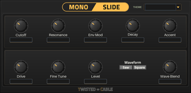

# MonoSlide for MPC

[](https://github.com/Eurikon/mpc-vst-plugins/actions/workflows/monoslide-check.yml)
[](LICENSE)
[](https://github.com/Eurikon/mpc-vst-plugins/releases/download/monoslide-v1.0.4/MonoSlide-1.0.4-mpc-armv7.zip)



MonoSlide is a monophonic acid bass instrument ported from TwinSlide's MonoSlide voice.<br>
It uses MPC's sequencer and receives MIDI on all channels, with last-note priority, overlapping-note slide and velocity-triggered accent.<br>
There are 18 sound parameters across Voice and Expert pages, plus a shared theme selector: Default, Copper, Glacier, Moss, Amethyst and Ember.<br>
The theme is saved with the instrument; older states select Default.

**Version:** 1.0.5, with ARMv7 and AArch64 builds for MPC OS 3.x.

## Build and test

Requires Docker with ARMv7 support, Python 3, Make and a C++17 compiler.<br>
Linux x86 emulation is also needed for wrapper tests on macOS or ARM hosts.<br>
Local skin previews require Python 3.11 and Chromium's runtime dependencies.<br>
Use the external [sd88me build tools](https://github.com/open-mpc/mpc-vst-plugins) at the pinned revision below; they are not bundled in this repository.

```sh
git clone https://github.com/Eurikon/mpc-vst-plugins.git
cd mpc-vst-plugins
git clone https://github.com/open-mpc/mpc-vst-plugins.git ../mpc-vst-build-tools
git -C ../mpc-vst-build-tools checkout 0dc17120cd7e952e95eeecdd820ac9e495a75ee9
export MPC_VST="$(cd ../mpc-vst-build-tools && pwd)"
cd Instruments/Monoslide
./test.sh
make skin
./build.sh
./package.sh 1.0.5
```

- `build.sh` applies or verifies the supplied patches, generates the skin and parameter table, then builds ARMv7 and AArch64 libraries using the upstream Docker workflow.
- `test.sh` runs engine tests and the original Linux x86 ASan/UBSan wrapper test, using Docker on macOS or ARM hosts.
- `make skin` creates local page previews with an isolated Python/Playwright environment under ignored `build/art-venv/` and `build/browser/`, using [requirements-art.txt](requirements-art.txt).<br>
  Existing development caches are reused when available.<br>
  Override `ART_PYTHON`, `ART_VENV` or `ART_BROWSER` as needed.
- `package.sh` creates the ARMv7, AArch64 and combined SDK-format ZIPs and runs the upstream catalog validator.<br>
  CPU metadata is included only when `bench.txt` matches the built library hash in `bench.sha256`.<br>
  An optional second argument selects another output directory.

Outputs are under ignored `build/` and `dist/`.<br>
The patches correct themed dropdown rendering, resource names and generated installation instructions; they do not change DSP or parameters.

## Installation

On **MPC OS 3.10.1 or later**, extract the SDK-format ZIP.<br>
Copy its `Twisted Cable - VST - MonoSlide` folder into `VST2 Plugins` at the root of your SD card or USB drive.<br>
In Preferences → Enhancements (Beta), enable **Enable Enhancements** and **External Plugin Support**.<br>
Restart the MPC application if the plugin is not listed, then choose MonoSlide under **External Plugins**.

On earlier supported firmware, install the appropriate ARMv7 or AArch64 ZIP through the [OpenMPC Plugin Manager](https://github.com/open-mpc/mpc-vst-plugins/tree/main/tools/plugin_manager_g2) or your existing [Plugin Manager USB](https://github.com/Eurikon/plugin-manager-usb-for-open-mpc).<br>
The scripted installer restarts the MPC application; save your project first.

## Local validation

**Tested on:** MPC Live 2 Retro — Gen1 / AKAI MPC OS 3.9.1, 3.10 and 3.10.1.

Release 1.0.4 was checked on OS 3.10; OS 3.9.1 checks used earlier releases.
The SDK migration's loading, playback, touchscreen/Q-Link controls and both pages were checked on OS 3.10.1.<br>
The 3.10.1 project save/reload recheck is deferred to the next update.<br>
Gen2 builds pass ARM64 Linux host, sanitizer and repeated-unload checks; physical Gen2 testing remains pending.

- Playback, project save/reload and two playing instances: confirmed on hardware during development.
- Interface and theme controls: confirmed on 06-10-2026; the centered title was confirmed on 13-10-2026.
- Native Q-Link automation: recording and Read playback verified on 06-11-2026 with synthetic encoder input through MPC's controller path.
- Native preset and project state: save/reload verified on 06-11-2026, including waveform and theme changes.
- Installation, managed removal and reinstallation: verified on 06-11-2026, including the installed payload, unrelated-file preservation, USB manifest and manager reopening shortcut.
- Idle CPU processing: reduced from **8.7%** to **7.5%** of one core on 14-10-2026, about **14% less CPU**.
- Device CPU benchmark: **PASS** on 13-11-2026 / OS 3.10.1, with p99 **10.9%** and maximum block **16.0%**.
- Regression validation: host, sanitized and native ARM output checks matched exactly across **27 cases and 2,772,485 frames** before and after optimization.
- Final release ZIP: all **24** offline installation/reinstallation/tamper/rollback/uninstallation checks passed.

CPU percentages measure a single core's 128-frame audio-block budget at 44,100 Hz, rather than the MPC overall CPU meter.<br>
The current package includes the measured CPU result and tested library SHA-256 `a38c4d3f3f27c58eddf24229cd9cc73765f0126498218aa340b994b769200ebf`.<br>
The current CPU figures were measured on OS 3.10.1.<br>
OS 2.x and other physical device/firmware combinations remain unverified.

## Licensing

GPL-3.0-or-later, with MIT Open303 components and public-domain Ooura FFT.<br>
Statically linked GCC runtime code retains its [Runtime Library Exception 3.1](licenses/GCC-Runtime-Exception-3.1.txt).<br>
See [LICENSE](LICENSE), `licenses/` and [src/VENDORED.md](src/VENDORED.md) for DSP provenance.
