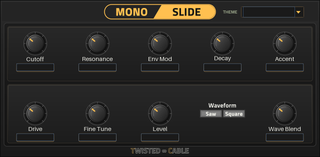

# Twisted Cable - MPC Plugins

Instruments and effects for MPC standalone. 
Each plugin has its own source, license and release package.

|  | Plugin | Type |
| --- | --- | --- |
|  | [MonoSlide](Monoslide/README.md) | Instrument |

## Hardware and software compatibility

**Tested locally:** MPC Live 2 Retro — Gen1 / AKAI MPC OS 3.9.1.

## Build from source

Follow each plugin's README for its commands and pinned external dependencies. 
No Docker images, Akai firmware or local development toolchain are bundled here. 
Build workflows use the external [sd88me MPC VST build tools](https://github.com/sd88me/mpc-vst-plugins). 
That project established the standalone plugin build, package and community catalog workflow used by this collection.

## Releases and installation

Each plugin is packaged and submitted to the community catalog separately. 
Release assets use plugin-specific names; source updates do not publish a new installer automatically. 
The [Plugin Manager USB](https://github.com/Eurikon/plugin-manager-usb) can install suitable released packages on the MPC.

## Licensing

Licenses apply per plugin, including its third-party notices. 
There is no single license covering the entire collection.
