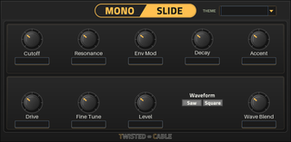
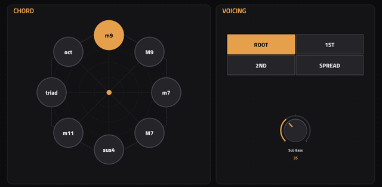

# Twisted Cable - MPC Plugins

Instruments and effects for MPC standalone. 
Each plugin has its own source, license and release package.

|  | Plugin | Type |
| --- | --- | --- |
|  | [MonoSlide](Instruments/Monoslide/README.md) | Instrument |
|  | [HexChord 73](Instruments/HexaChord-73/README.md) | Instrument |

## Hardware and software compatibility

**Tested locally:** MPC Live 2 Retro — Gen1 / AKAI MPC OS 3.9.1, 3.10 and 3.10.1. 
Gen2 builds are checked offline on ARM64 Linux; physical Gen2 testing remains pending. 
Each plugin's page records its compatibility and test coverage.

## Build from source

Follow each plugin's README for its commands and pinned external dependencies. 
No Docker images, Akai firmware or local development toolchain are bundled here. 
Build workflows use the external [Open MPC VST build tools](https://github.com/open-mpc/mpc-vst-plugins). 
That project established the standalone plugin build, package and community catalog workflow used by this collection.

## Releases and installation

Each plugin is packaged and submitted to the community catalog separately. 
Release assets use plugin-specific names; source updates do not publish a new installer automatically. 
On MPC OS 3.10.1 or later, copy the SDK-format plugin folder into `VST2 Plugins` at the root of a drive. 
The [OpenMPC Plugin Manager](https://github.com/open-mpc/mpc-vst-plugins/tree/main/tools/plugin_manager_g2) also installs community releases. 
Existing [Plugin Manager USB](https://github.com/Eurikon/plugin-manager-usb-for-open-mpc) installations remain an option on earlier supported firmware.

## Licensing

Licenses apply per plugin, including its third-party notices. 
There is no single license covering the entire collection.
